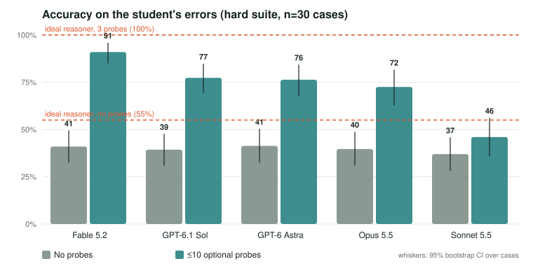
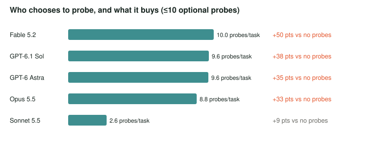

# BEHAVIOR-PROBE: do agents ask before they assume?

Most benchmarks hand an agent everything it needs and grade the final answer. Real work rarely looks like that: the evidence is thin, several explanations fit it, and the right move is to check before committing. BEHAVIOR-PROBE tests exactly that habit. Each task is a simulated student who subtracts with a hidden, systematic bug; the agent sees four of the student's past answers and has to predict what this student will write on 40 new problems, scored only on the problems the student gets wrong. In one condition the agent can optionally ask the student up to ten new problems first. Without that option, every frontier model we tested lands between 37% and 41%, below the 55% an ideal reasoner gets from the same evidence. With it, scores spread from 46% to 91%, and the gap comes down to whether a model chooses to ask, and how well it picks its questions.



## How it works

Each task is one simulated student who subtracts with a hidden, systematic bug (Note: This virtual student is implemented entirely via hardcoded logic in a **Python script**, with **no LLM** involvement in the simulation). The agent gets:

- **4 of the student's past answers**, chosen so that many different bugs fit them;
- **40 new problems** (3 to 5 digits), chosen where those candidate bugs disagree;
- in the probe condition, an optional **`probe A B`** command that shows the student's answer to any new problem (up to 10 times; the prompt says using it is "entirely up to you").

It writes `/workspace/submission.json`: an integer answer and a confidence for each problem. **The score is accuracy on the 20 problems where the student gets it wrong**, so getting the arithmetic right earns nothing; the agent has to model the bug.

| | |
|---|---|
| Possible students | 2,304: two interacting components, each one of 6 bugs (subtract smaller from larger, borrow without decrementing, write 0, borrow from two columns over, decrement twice, copy the bottom digit) × 8 triggers (any column, ones, tens, hundreds+, next digit 0, incoming borrow, bottom digit ≥ 7, top digit 0) |
| Ambiguity, by design | the 4 observations are chosen so that many students fit them; test questions are where those students disagree |
| Solvable, by construction | each case records an **ideal reasoner** (uniform prior over all 2,304 students, majority vote): **55.0%** from the observations alone, **100.0%** after 3 well-chosen probes |
| Validity | no problem requires a step a real student couldn't write (a digit outside 0–9, or a borrow past the leftmost column) |
| Cases in this release | 30 hard students × 2 conditions (`hard-noprobe`, `hard-probe10`) |

## What it found

| Model | Harness | No probes | ≤10 optional probes | Gain | Probes / task | Cases probed |
|---|---|---|---|---|---|---|
| Claude Fable 5.2 | Claude Code (`claude_code-bp`) | **41.0** (32.5–49.5) | **91.0** (85.0–96.0) | +50.0 | 10.0 | 30/30 |
| GPT-6.1 Sol | Codex (`codex-v1.0.0`) | **39.3** (30.8–47.7) | **77.3** (69.2–84.8) | +38.0 | 9.6 | 29/30 |
| GPT-6 Astra | Codex (`codex-v1.0.0`) | **41.3** (32.5–50.3) | **76.3** (67.7–84.3) | +35.0 | 9.6 | 30/30 |
| Claude Opus 5.5 | Claude Code (`claude_code-bp`) | **39.7** (30.8–48.8) | **72.5** (62.7–81.7) | +32.8 | 8.8 | 29/30 |
| Claude Sonnet 5.5 | Claude Code (`claude_code-bp`) | **37.0** (28.2–45.8) | **46.0** (35.7–56.2) | +9.0 | 2.6 | 10/30 |
| *Ideal reasoner* | – | *55.0* | *100.0 (with 3 probes)* | | | |

Accuracy on the student-error questions, %, with 95% bootstrap CIs over 30 cases. "Gain" is the change versus the same model with no probes, on the same cases.



1. **Without probes, every model is below the ideal reasoner's 55.0%** (37.0–41.3%). With only 4 observations, models commit to one rule that fits and stop. No pair of models differs significantly.
2. **With optional probes, the spread is 45.0 points** (46.0–91.0%). Significant differences: Claude Fable 5.2 > Claude Opus 5.5 by 18.5 pts (95% CI 9.7–28.0); Claude Fable 5.2 > Claude Sonnet 5.5 by 45.0 pts (95% CI 35.0–55.0); Claude Fable 5.2 > GPT-6 Astra by 14.7 pts (95% CI 7.3–22.7); Claude Fable 5.2 > GPT-6.1 Sol by 13.7 pts (95% CI 7.3–20.7); Claude Opus 5.5 > Claude Sonnet 5.5 by 26.5 pts (95% CI 14.0–39.5); GPT-6 Astra > Claude Sonnet 5.5 by 30.3 pts (95% CI 18.2–42.5); GPT-6.1 Sol > Claude Sonnet 5.5 by 31.3 pts (95% CI 20.0–43.0).
3. **How a model probes matters, not just how many times.** Claude Fable 5.2 used 10.0 probes per task and reached 91.0%. GPT-6.1 Sol, GPT-6 Astra, Claude Opus 5.5 used almost as many (8.8–9.6) but reached only 72–77%. Claude Sonnet 5.5 probed in 10 of 30 cases (2.6 per task) and gained 9.0 points. No model reaches the ideal reasoner's 100.0% with 3 probes.
4. **Bigger problems are where fitted rules break.** Without probes, every model scores 54–57% on 3-digit error questions but only 22–27% on 4–5-digit ones. With probes, Claude Fable 5.2 closes the gap (91.0% vs 91.0%); GPT-6.1 Sol, GPT-6 Astra, Claude Opus 5.5, Claude Sonnet 5.5 still drop 20–34 points.

### A concrete failure

**Case H020.** The hidden rule (never shown to the agent): when a column needs a borrow, the student copies the bottom digit instead of borrowing in the hundreds column or higher; otherwise, borrows from two columns to the left in the ones column. The ideal reasoner gets 55% from the observations alone and 100% with 3 probes.

| Observed | Student wrote | Correct |
|---|---|---|
| 167 − 56 | **111** | 111 |
| 203 − 106 | **7** | 97 |
| 9344 − 6683 | **3661** | 2661 |
| 246 − 63 | **183** | 183 |

**Claude Opus 5.5, no probes: 0%** on the student's errors (0% on 4–5-digit problems). Its conclusion:

> I've written predictions for all 40 problems to `/workspace/submission.json`. The rule I inferred reproduces all four of the student's past answers exactly, but it rests on only two buggy examples, so treat it as a best guess. **The student's likely procedure:** - **Borrowing across a zero:** they skip the zero and take 1 from the next digit to the left, but leave the zero as 0 instead of turning it into 9. That's how 203 − 106 became 7 instead of 97. - **Two borrows in a row:** if a column has already been reduced by 1 because a borrow came out of it, and then that column has to borrow too, …

**Claude Opus 5.5, same case, ≤10 optional probes: 100%** (10 probes). What it asked:

| Probe | Student wrote | Correct |
|---|---|---|
| 5432 − 2678 | **3664** | 2754 |
| 4005 − 1237 | **3278** | 2768 |
| 305 − 107 | **108** | 198 |
| 7321 − 2456 | **5475** | 4865 |
| 1000 − 1 | **1009** | 999 |
| 432 − 178 | **164** | 254 |
| 5732 − 2178 | **3464** | 3554 |
| 5378 − 1612 | **4666** | 3766 |
| 13512 − 4201 | **14311** | 9311 |
| 62000 − 1 | **62009** | 61999 |

> I wrote predictions for all 40 questions to `/workspace/submission.json`. I used all 10 probes. The rule I worked out matches every known answer: the 4 given ones and the 10 probes. **The student's rule:** - **Ones and tens columns:** When the top digit is smaller, the student borrows correctly and works out 10 + top − bottom. But the borrow is always taken from the **hundreds** digit, never from the column next door. So a borrow in the ones column skips the tens digit, and every borrow lowers the hundreds digit by one. - **Hundreds column and higher:** When the top digit (after any borrows …

**Claude Sonnet 5.5, same case, same optional probes:** 0 probes, **0%**.

> I wrote `/workspace/submission.json` with all 40 predictions. I didn't use the `probe` tool, so every prediction rests on the four past answers. **What the student seems to do:** three of the four past answers are correct, so I assumed correct subtraction by default. The exception is 203 − 106, where the student gave 7 instead of 97. My guess is that when a borrow has to come from a zero digit, …

The four observations fit many rules. Without probes, the model picked one and applied it confidently. With probes, it tested the rule on new problems and corrected it. The benchmark measures that difference.

### Detail

**No probes**

| Model | Error-question acc. | 95% CI | All 40 questions | 3-digit | 4–5-digit | Brier ↓ | Valid |
|---|---|---|---|---|---|---|---|
| Claude Fable 5.2 | 41.0 | 32.5–49.5 | 57.4 | 56.7 | 25.3 | 0.321 | 30/30 |
| GPT-6.1 Sol | 39.3 | 30.8–47.7 | 59.6 | 56.3 | 22.3 | 0.346 | 30/30 |
| GPT-6 Astra | 41.3 | 32.5–50.3 | 59.1 | 55.3 | 27.3 | 0.348 | 30/30 |
| Claude Opus 5.5 | 39.7 | 30.8–48.8 | 57.6 | 54.7 | 24.7 | 0.348 | 30/30 |
| Claude Sonnet 5.5 | 37.0 | 28.2–45.8 | 54.4 | 54.5 | 22.1 | 0.251 | 29/30 |

**≤10 optional probes**

| Model | Error-question acc. | 95% CI | All 40 questions | 3-digit | 4–5-digit | Brier ↓ | Valid |
|---|---|---|---|---|---|---|---|
| Claude Fable 5.2 | 91.0 | 85.0–96.0 | 95.5 | 91.0 | 91.0 | 0.099 | 30/30 |
| GPT-6.1 Sol | 77.3 | 69.2–84.8 | 81.1 | 89.0 | 65.7 | 0.170 | 30/30 |
| GPT-6 Astra | 76.3 | 67.7–84.3 | 85.0 | 86.7 | 66.0 | 0.168 | 30/30 |
| Claude Opus 5.5 | 72.5 | 62.7–81.7 | 79.2 | 82.7 | 62.3 | 0.199 | 30/30 |
| Claude Sonnet 5.5 | 46.0 | 35.7–56.2 | 58.2 | 66.1 | 32.5 | 0.274 | 28/30 |

## How it's built (Valkyrie + Harbor)

Every task is a [Harbor](https://docs.harborframework.com/tasks/overview) task, pushed to Valkyrie as `behavior-probe/hard-noprobe` and `behavior-probe/hard-probe10` and run on Modal.

```
harbor/datasets/hard-probe10/h001-p10/
├── instruction.md            # the student's 4 answers + 40 questions (public)
├── task.toml                 # limits; agent network = model APIs + oracle only
├── environment/
│   ├── Dockerfile            # agent image (Claude Code, Codex preinstalled) + `probe` client
│   ├── docker-compose.yaml   # main + oracle sidecar
│   └── oracle/               # the ONLY place the hidden rule exists during the run
└── tests/                    # answer key + grader, copied in after the agent finishes
```

- **The agent never sees the answer.** The hidden rule lives in an `oracle` sidecar container. It answers `probe A B`, enforces the budget of 10, refuses the 40 test questions and logs every probe. The answer key arrives in `tests/` only after the agent is done.
- **No public internet for the agent.** During the run it can reach only the model APIs and the oracle.
- **Rich reward.** `tests/grade.py` writes `reward.json` with the reward (error-question accuracy) plus overall accuracy, 3-digit and 4–5-digit accuracy, Brier score and probes used.
- **Harnesses.** We use the two harnesses Valkyrie provides out of the box: Claude Code for Claude models, Codex for GPT models. Each is its provider's own agent, so every model runs in the setup it was built for. The task needs only a shell, file writes and the `probe` command, so neither harness has a tool advantage. The trade-off is that harness and model are confounded across providers (see Limitations).

## Run it

```bash
uv tool install valkyrie-cli && valkyrie login
valkyrie org use <your-org>
python3 harbor/build_tasks.py --cases 30            # build the Harbor tasks from hard_cases/
valkyrie dataset push behavior-probe/hard-noprobe harbor/datasets/hard-noprobe --tag v2
valkyrie dataset push behavior-probe/hard-probe10 harbor/datasets/hard-probe10 --tag v2
valkyrie agent push valkyrie/agents/claude_code-bp && valkyrie agent push valkyrie/agents/codex-v1.0.0
valkyrie run start --agent claude_code-bp --dataset behavior-probe/hard-probe10@v2 \
  --model anthropic/claude-opus-5-5 --provider modal -s ANTHROPIC_API_KEY <your-anthropic-secret> --concurrency 5
python3 harbor/analyze_hosted.py && python3 harbor/build_readme.py   # results, charts, this README
```

Modal needs `"runtime": "vm"` in its Valkyrie credentials for the sidecar (`harbor/connect_modal.sh` sets this up from `~/.modal.toml`). Cases are deterministic: `python3 hard_probe.py generate --root hard_cases --n 60 --seed 7`. Self-checks: `python3 hard_probe.py check` and `python3 -m unittest test_behavior_probe`.

### Runs (traces)

| Model | Condition | Valkyrie run ID |
|---|---|---|
| Claude Opus 5.5 | `hard-noprobe` | `d4a79287-b2af-4e85-9191-47ccd7ec060b` |
| Claude Fable 5.2 | `hard-noprobe` | `f339c122-2495-4e9b-aaed-049af0e90e67` |
| Claude Sonnet 5.5 | `hard-noprobe` | `b7c97645-1687-4a26-b309-5d2e3a9a1a7a` |
| GPT-6 Astra | `hard-noprobe` | `253aef9e-a15d-4e04-ab0e-b7309095756e` |
| GPT-6.1 Sol | `hard-noprobe` | `94b29947-ad98-4f9e-b42d-0e60f39b7ac2` |
| Claude Opus 5.5 | `hard-probe10` | `47125056-5346-4655-93e2-148c5a1f0e2c` |
| Claude Fable 5.2 | `hard-probe10` | `cb54e816-7a88-447f-8309-d92ac1ccf868` |
| Claude Sonnet 5.5 | `hard-probe10` | `48fb76b1-4b90-47f2-bcba-085ced130050` |
| GPT-6 Astra | `hard-probe10` | `56c5b35c-77f0-4790-b50e-ddebc4692cbb` |
| GPT-6.1 Sol | `hard-probe10` | `8b3f74a1-8d2d-40af-86d1-a529390c96d0` |

`valkyrie run fetch <id>` or `valkyrie tui` shows every task's log, the agent's full trajectory, its probes and the grader's output.

## Limitations

- **Synthetic students.** This measures hypothesis testing under controlled ambiguity, not tutoring real learners.
- **Harness confound.** Claude models ran on Claude Code and GPT models on Codex, so gaps between providers mix model and harness.
- **One run per cell, 30 cases.** The confidence intervals cover case sampling, not run-to-run variation.
- **Free probes.** Within the budget, probes cost nothing. A cost-weighted score would reward the most informative question more directly.

## Also in this repo

- `hard_probe.py` (hard suite generator and simulator) and `behavior_probe.py` (original easy suite and grader).
- `valkyrie/`: an earlier self-hosted Valkyrie version (custom benchmark service, local Docker). Its results include a 20-case easy suite and 60-case hard runs; see `submission/BENCHMARK.md`.
- `behavior_probe_report.html`: an interactive report of those earlier runs (inputs diff, every task, run comparison).
- `docs/ORIGINAL_SPEC.md`: the original benchmark spec.
