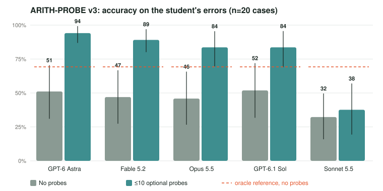
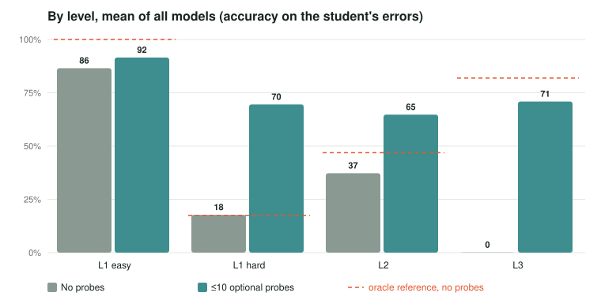

# ARITH-PROBE v3: results

Hosted Valkyrie runs on Modal, 2026-11-15. 20 cases (8 Level 1 easy, 4 Level 1 hard, 4 Level 2,
4 Level 3), each run with no probes (`arith-probe/v3-noprobe@v3`) and with up to 10 optional probes
(`arith-probe/v3-probe10@v3`). Score = exact-match accuracy on the held-out questions the simulated
student gets **wrong** (v3's primary metric), averaged over cases, with 95% bootstrap CIs over cases.
All 10 runs completed with 0 errored tasks.

## Headline

| Model | Harness | No probes | ≤10 optional probes | Gain | Probes / task | Cases probed |
|---|---|---|---|---|---|---|
| GPT-6 Astra | Codex (`codex-v1.0.0`) | **51.1** (31.0–70.5) | **94.1** (86.9–99.2) | +43.0 | 7.2 | 20/20 |
| Claude Fable 5.2 | Claude Code (`claude_code-bp`) | **47.0** (27.4–66.8) | **89.1** (80.1–97.0) | +42.1 | 8.3 | 20/20 |
| GPT-6.1 Sol | Codex (`codex-v1.0.0`) | **51.9** (31.8–72.0) | **83.6** (69.0–95.6) | +31.8 | 7.0 | 20/20 |
| Claude Opus 5.5 | Claude Code (`claude_code-bp`) | **45.9** (26.6–65.8) | **83.6** (69.6–95.5) | +37.8 | 7.4 | 20/20 |
| Claude Sonnet 5.5 | Claude Code (`claude_code-bp`) | **32.3** (15.9–49.6) | **37.6** (19.4–57.0) | +5.4 | 2.2 | 5/20 |
| *Oracle reference* | – | *69.3* | – | | | |

The oracle reference is v3's majority vote over every rule in its hypothesis family that fits the
observations. It is a baseline from the given evidence, not an upper bound.

## By level

| | L1 easy (8) | L1 hard (4) | L2 mixed (4) | L3 cross-op (4) |
|---|---|---|---|---|
| *Oracle reference, no probes* | *100.0* | *17.5* | *46.9* | *81.9* |
| GPT-6.1 Sol, no probes | 98.8 | 18.8 | 42.5 | **0.6** |
| GPT-6 Astra, no probes | 97.5 | 18.8 | 41.9 | **0.0** |
| Fable 5.2, no probes | 87.5 | 18.8 | 41.2 | **0.0** |
| Opus 5.5, no probes | 87.5 | 18.8 | 35.6 | **0.0** |
| Sonnet 5.5, no probes | 61.3 | 13.8 | 25.0 | **0.0** |
| GPT-6 Astra, ≤10 probes | 98.8 | 93.8 | 80.0 | 99.4 |
| Fable 5.2, ≤10 probes | 100.0 | 93.8 | 78.8 | 73.1 |
| GPT-6.1 Sol, ≤10 probes | 98.8 | 71.2 | 73.1 | 76.2 |
| Opus 5.5, ≤10 probes | 100.0 | 70.0 | 66.9 | 81.2 |
| Sonnet 5.5, ≤10 probes | 60.0 | 18.8 | 25.0 | 24.4 |

## What it found

1. **Probing is where the models separate.** With optional probes, four models gain 32–43 points
   and land at 84–94%. GPT-6 Astra is highest (94.1%). It beats Opus 5.5 (+10.5 pts, CI 0.8–23.2)
   and GPT-6.1 Sol (+10.5, CI 0.8–24.0), but its lead over Fable 5.2 (+5.0, CI −1.2 to 13.0) is not
   significant. Fable, Opus and Sol are not significantly different from each other.
2. **Sonnet 5.5 mostly doesn't ask.** It probed in 5 of 20 cases (2.2 probes per task) and gained
   5.4 points. Every other model probed in all 20. Sonnet is significantly below every other model
   in both conditions. This matches the earlier `behavior-probe` benchmark.
3. **Without probes, the GPT models lead on easy Level 1.** They score 97.5–98.8% there vs 87.5% for
   Fable and Opus. That puts GPT-6.1 Sol significantly above Fable (+4.9, CI 0.1–12.9) and Opus
   (+6.0, CI 0.4–14.2) overall without probes. The Astra vs Claude gaps are not significant.
4. **Level 3 transfer fails without probes for every model.** On the 4 Level-3 cases, the models
   score 0–0.6% on the student's errors. Overall accuracy is 34–50%, at or below the 50% that
   answering with correct arithmetic would score, so no model picked up the one clue in the
   observations (e.g. 964 × 91 → 86760, which is 964 × 90). The oracle reference gets 81.9% from
   the same evidence. With probes, recovery ranges from 73% (Fable) to 99% (Astra), but each of
   those runs probed the target operation, so v3 reports no clean transfer score for them.
5. **Level 1 hard is underdetermined without probes.** Every model lands near the oracle reference
   (14–19% vs 17.5%). With probes, GPT-6 Astra and Fable reach 93.8%, and Sol and Opus about 70%.
6. **Calibration improves with evidence.** Brier score on error questions falls from 0.28–0.37 with
   no probes to 0.04 (Astra), 0.08 (Fable), 0.10 (Sol) and 0.12 (Opus) with probes. Sonnet stays
   at 0.27.
7. **Observed K100** (first saved snapshot with every error question right): Astra 15 of 20 probe
   cases (after 4.8 probes on average), Fable 13 (5.2), Opus 13 (5.2), Sol 12 (5.1), Sonnet 3.
   These counts come only from the snapshots the agents chose to save.

## Detail

| Model | Condition | Error acc. | All questions | Brier ↓ | ECE ↓ | Valid | Snapshots / task |
|---|---|---|---|---|---|---|---|
| GPT-6.1 Sol | no probes | 51.9 | 69.2 | 0.346 | 0.419 | 20/20 | 1.0 |
| GPT-6 Astra | no probes | 51.1 | 69.5 | 0.369 | 0.427 | 20/20 | 1.0 |
| Fable 5.2 | no probes | 47.0 | 65.9 | 0.278 | 0.429 | 20/20 | 1.0 |
| Opus 5.5 | no probes | 45.9 | 65.7 | 0.346 | 0.474 | 20/20 | 1.0 |
| Sonnet 5.5 | no probes | 32.3 | 62.6 | 0.301 | 0.426 | 20/20 | 1.0 |
| GPT-6 Astra | ≤10 probes | 94.1 | 94.9 | 0.038 | 0.054 | 20/20 | 9.4 |
| Fable 5.2 | ≤10 probes | 89.1 | 91.2 | 0.079 | 0.169 | 20/20 | 12.2 |
| GPT-6.1 Sol | ≤10 probes | 83.6 | 88.9 | 0.102 | 0.126 | 20/20 | 9.3 |
| Opus 5.5 | ≤10 probes | 83.6 | 88.1 | 0.116 | 0.207 | 20/20 | 8.6 |
| Sonnet 5.5 | ≤10 probes | 37.6 | 64.1 | 0.273 | 0.428 | 20/20 | 1.6 |

"Snapshots" includes the final submission. All pairwise comparisons (paired bootstrap over cases)
are in `results/hosted/final.json`: 12 of 20 pairs are significant.

## Caveats

- **Level 3 uses one rule.** All 4 Level-3 cases share the same hidden rule (`one_as_zero`,
  trigger `any`), so the Level-3 numbers measure one shared misreading, not transfer in general.
  This comes from the v3 generator and seed, not the Harbor port.
- **20 cases, one run per cell.** The CIs are wide (about ±20 pts with no probes). They cover
  case sampling, not run-to-run variation.
- **Harness confound.** Claude models ran on Claude Code and GPT models on Codex, so gaps between
  providers mix model and harness.
- **GPT reruns.** The first GPT runs hit an OpenAI quota error partway through. They were discarded
  and rerun in full with a new key; the discarded IDs are in `harbor/runs_gpt_quota_failed.tsv`.
- **v3 scores are not comparable to the earlier `behavior-probe` results.** They use different
  tasks, rules and metric populations.

## Runs (traces)

| Model | Condition | Valkyrie run ID |
|---|---|---|
| GPT-6 Astra | `v3-noprobe` | `d040bef5-f912-4fc9-9185-cefa08c34500` |
| GPT-6 Astra | `v3-probe10` | `185c489b-fd06-4b5a-bbed-7b7f3b4222e8` |
| GPT-6.1 Sol | `v3-noprobe` | `5a481783-cd53-4dbc-9c25-209c7775f164` |
| GPT-6.1 Sol | `v3-probe10` | `338d177f-2b6f-4b9e-83e3-bcb05923e3c5` |
| Claude Fable 5.2 | `v3-noprobe` | `bc424fe5-69d3-42fc-a09e-d913c1496587` |
| Claude Fable 5.2 | `v3-probe10` | `7def8afb-1e84-4fdc-8d28-4622186f3041` |
| Claude Opus 5.5 | `v3-noprobe` | `5f73515d-e695-47aa-b111-ab5c93a4edf3` |
| Claude Opus 5.5 | `v3-probe10` | `efd62e4c-508d-4756-b737-78b9edc5a904` |
| Claude Sonnet 5.5 | `v3-noprobe` | `88fb6741-a415-43a7-8694-fce6efa76196` |
| Claude Sonnet 5.5 | `v3-probe10` | `36e66b93-07d0-44ab-9c60-ac214f02985a` |

Reproduce: `python3 arith_v3/harbor/analyze_hosted.py` (reads `harbor/runs_hosted.tsv`, writes
`results/hosted/final.json` and the charts).
